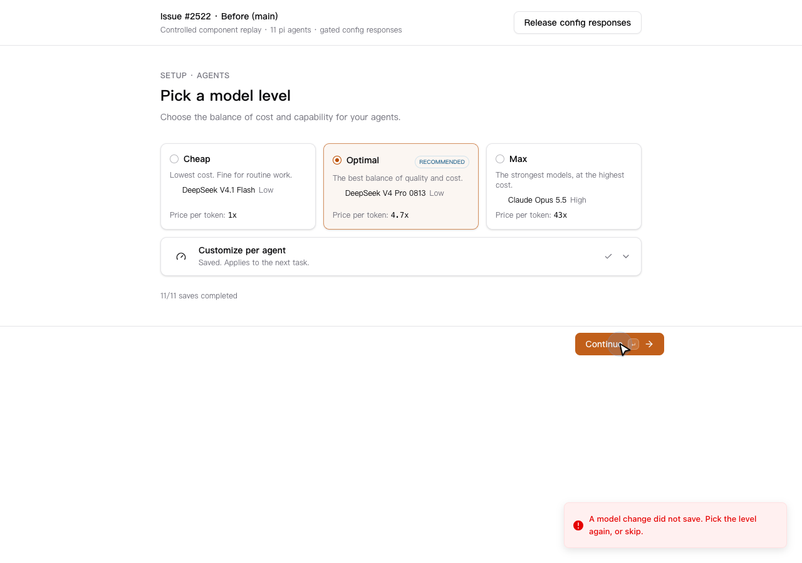
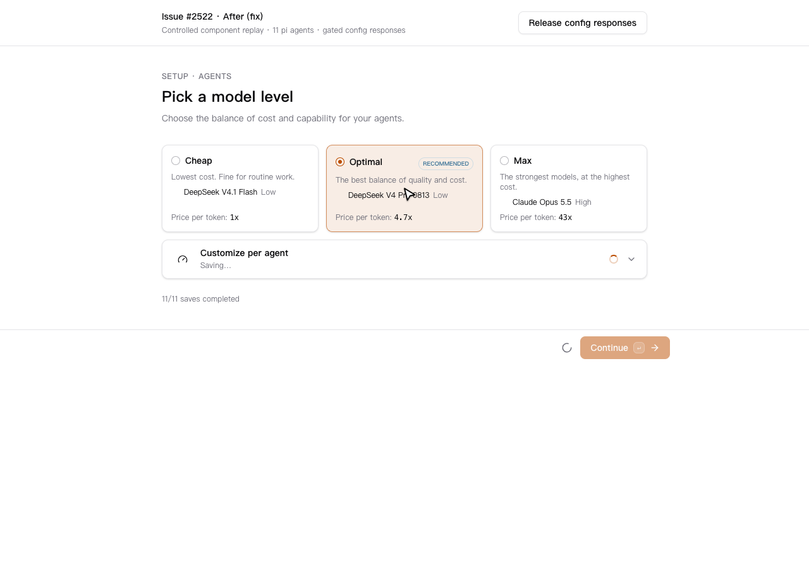
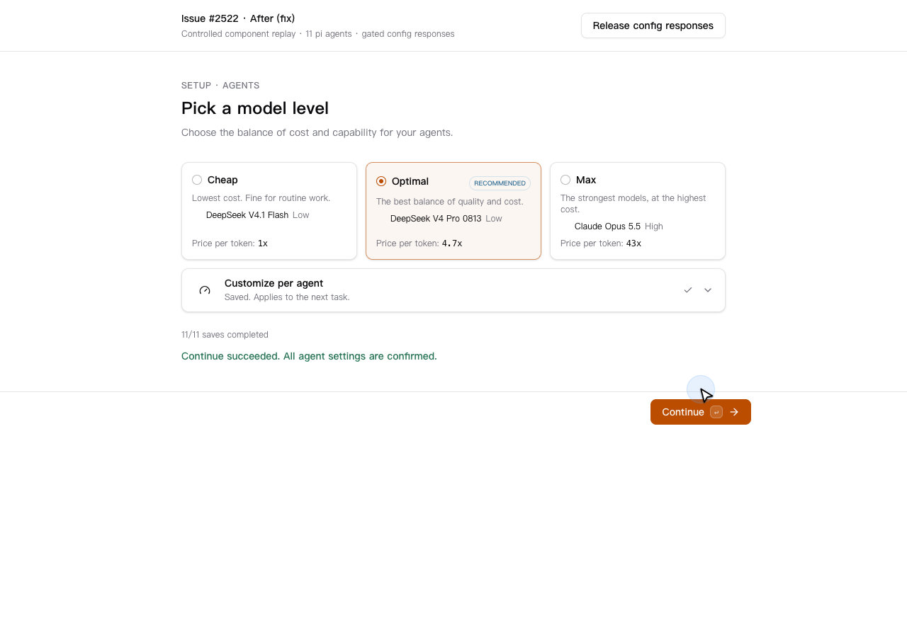

# Issue #2522: controlled component replay

Evidence for https://github.com/desplega-ai/agent-swarm/issues/2522.

Both recordings render the real AgentModels, autosave scope and SetupFooter with eleven pi agents. The API client is controlled to complete all saves while holding ten resolved-config responses. This is a component replay, not a hosted-dashboard or full-install test.

The before bundle uses main at 7716d50d97949a63367a934028e15305ce0b6d0a. The after bundle uses the fix/setup-model-save-refresh branch. Captured locally with agent-browser 0.40.0 and Chrome 156.0.8078.73, at 1280 x 900. Recordings play at 1.5x.

| Before: Saved, Continue throws | After: Saving, Continue blocked |
| --- | --- |
|  |  |

After releasing the held responses, Continue succeeds without another model selection or save:

Recordings: [before](before.mp4), [after](after.mp4).
