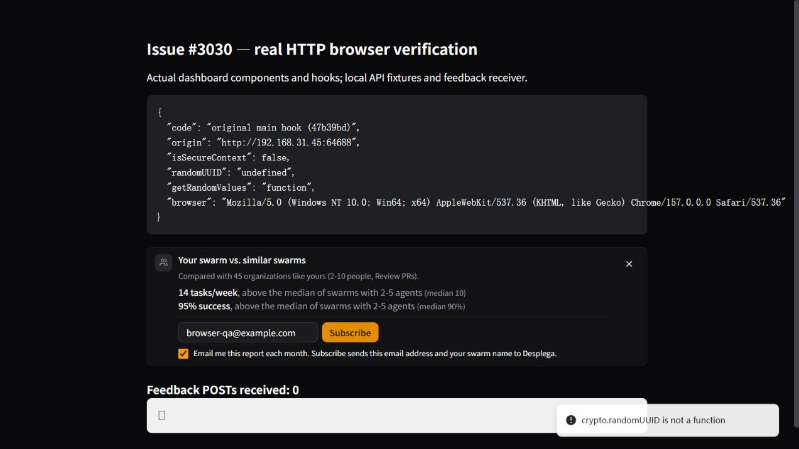
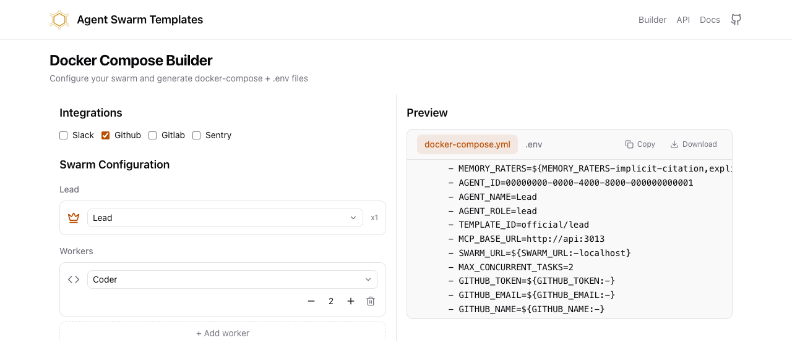

# Real HTTP browser verification for issue #3030

Tested on 2026-11-12 (Asia/Singapore) in the Chromium 157 in-app browser on Windows.

| Source | Origin | Secure context | Native randomUUID | Result |
|---|---|---|---|---|
| Original subscription hook from `main@47b39bd` | LAN HTTP | false | undefined | Error toast; zero feedback POSTs |
| PR #3031 at `c1c3c6c269f3c0ffdeb28e70b30bf07f5844c7e1` | Same LAN HTTP | false | undefined | Success UI; one POST with a valid UUID v4 |
| Original subscription hook | localhost HTTP | true | function | Success UI; one additional POST with a valid UUID v4 |

The browser's crypto object was never patched. This focused harness bundles the real `FleetBenchmarkCard`, `FleetReportForm`, providers and API client. The before bundle substitutes only the original subscription hook's source from Git. The API data and feedback receiver are local fixtures. The feedback endpoint accepts the actual browser POST and validates the UUID. No subscription was sent to the production feedback service.

The after screenshot shows two receipts because the localhost positive control ran after the LAN test; their `origin` fields distinguish them.

## Evidence

- [Before: actual LAN HTTP failure](before.png)
- [After: success and server receipts](after.png)
- [Localhost positive control](localhost-control.png)
- [Raw feedback receipts](receipts.json)

